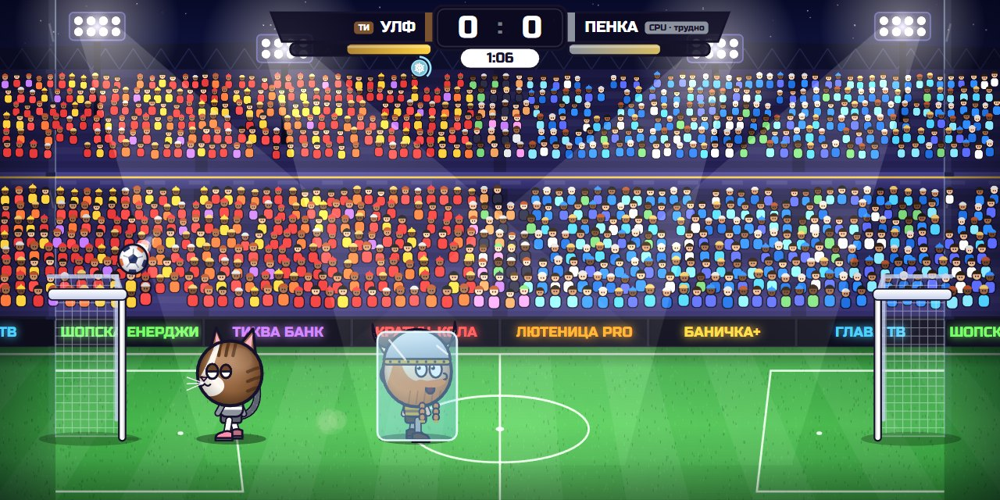
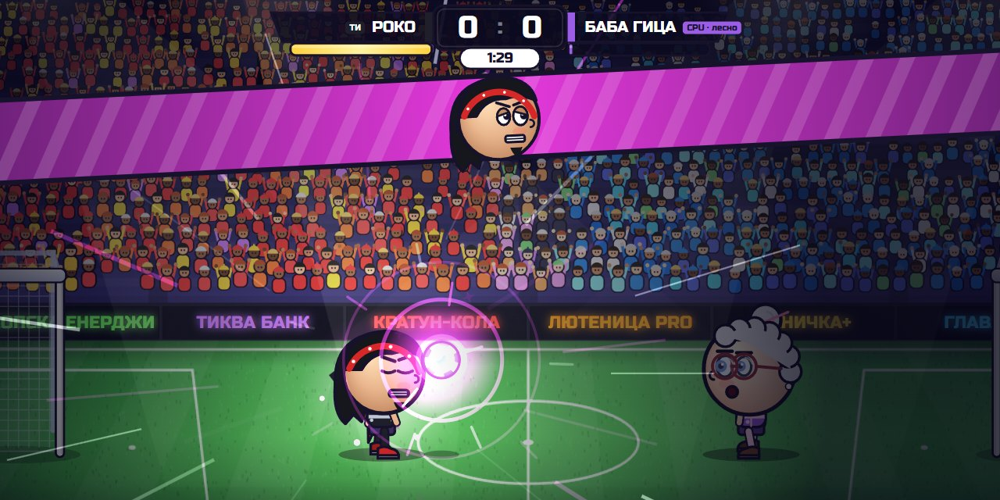

# ⚽ Кратунбол

**Футбол с големи глави, 1 срещу 1.** 16 герои с луди супер удари, пет стадиона с различно време, лига, турнир, предизвикателство на деня, луди режими, магазин с козметика и онлайн мачове с приятел. Играе се направо в браузъра, на компютър или на телефон.

### ▶ [Играй сега](https://vasilnikolov16.github.io/big-head-football/)

---

## 🎮 Как се играе

Вкарай повече голове от противника, преди да изтече времето. Ако е равно, следва **златен гол**: който вкара пръв, печели.

Топката е жива: отскача от главите, гредите и стената над вратите. Удряй я с глава, ритай я във въздуха и чакай момента за супер удар. Ако двамата ритнете топката едновременно, тя изскача нагоре и започва боричкане.

## ⌨️ Управление

|                | Играч 1 (ляв) | Играч 2 (десен)       |
| -------------- | :-----------: | :-------------------: |
| Движение       | A / D         | ← / →                 |
| Скок           | W             | ↑                     |
| Ритник         | S             | ↓                     |
| Супер удар     | Left Shift    | Right Shift или Enter |
| **Даш**        | 2× A или 2× D | 2× ← или 2× →         |

- **Esc** или **P**: пауза
- Всички клавиши се сменят от **Настройки → Контроли**

## 📱 На телефон

Обърни телефона хоризонтално. Играта запълва целия екран.

- **Вляво:** ◀ ▶. Бързо докосване два пъти е даш.
- **Вдясно:** ⚡ Супер · 👟 Ритник · ⬆ Скок. Палецът може да се плъзга от бутон на бутон.
- **Горе вляво:** ❚❚ пауза.

**Сложи я като приложение.** Така играта се отваря на цял екран, с иконка, и работи и без интернет (освен онлайн играта):

- **iPhone / iPad:** отвори линка в Safari → **Сподели** (квадратче със стрелка) → **Добави към началния екран**
- **Android:** в Chrome менюто **⋮** → **Инсталирай приложението**

Новите версии се зареждат сами.

## 🦸 Герои

| Герой | Скорост | Скок | Сила | Глава | Супер удар | Ако го спреш… |
| ----- | :-----: | :--: | :--: | :---: | ---------- | ------------- |
| **Бобо**, бръснарят | 3 | 3 | 4 | 3 | **Бръсначен удар**: ниска свистяща топка | отхвърчаш назад |
| **Пенка**, котката | 4 | 5 | 2 | 3 | **Котешки скок**: задрямва във въздуха и се хвърля | издраскан и замаян |
| **Бип-0**, роботът | 2 | 2 | 5 | 4 | **Лазер**: права линия с огромна скорост | токов удар |
| **Роко**, рокерът | 4 | 3 | 3 | 3 | **Соло на китара**: звукова вълна | обърнато управление |
| **Баба Гица** | 2 | 2 | 3 | 5 | **Кълбо прежда**: самонасочва се | оплетен и бавен |
| **Пипер**, готвачът | 3 | 3 | 4 | 3 | **Горещ тиган**: палачинката се обръща и пада във вратата | опарен |
| **Влад**, вампирът | 4 | 4 | 3 | 2 | **Ято прилепи**: лети на зигзаг | губиш сила и енергия |
| **Огнян**, пожарникарят | 3 | 3 | 4 | 4 | **Воден маркуч**: ниска водна струя | отнася те |
| **Снежко**, снежният човек | 2 | 3 | 4 | 4 | **Лавина**: снежна топка, която расте | замръзваш |
| **Капитан Рум**, пиратът | 3 | 2 | 5 | 3 | **Гюле**: висока дъга и взрив | главата ти се смачква |
| **Бойко**, боксьорът | 4 | 3 | 4 | 2 | **Кроше**: излита и завива към вратата | нокдаун, объркани посоки |
| **Зиг**, извънземното 🔒 | 3 | 5 | 2 | 4 | **Телепорт**: появява се пред вратата | отвлечен нагоре |
| **Улф**, викингът 🔒 | 2 | 3 | 5 | 4 | **Гръм**: забива се като мълния | зашеметен |
| **Сенко**, нинджата 🔒 | 5 | 4 | 3 | 1 | **Сенки**: три топки, една истинска | забавен в облак дим |
| **Звездан**, магьосникът 🛒 | 3 | 4 | 3 | 4 | **Звездна магия**: скача през пространството | ставаш жаба и не скачаш |
| **Рекс**, динозавърът 🛒 | 3 | 2 | 5 | 4 | **Рев**: ударна вълна по земята | изхвърля те във въздуха |

🔒 Отключват се в **Турнира**. 🛒 Купуват се в **Магазина**.

## ⚡ Супер удар

1. Лентата под името ти се пълни сама с времето и малко по-бързо, когато играеш с топката.
2. Когато е пълна, натисни **Супер**. Героят засиява и всеки чува неговия сигнал.
3. Следващото ти докосване на топката я хваща. Играта замръзва, топката се зарежда пред героя и тогава изригва ударът.

Зареденият удар не изчезва след гол, но не може да се ползва, докато се празнува.

**Всеки супер удар може да бъде спрян**, но който го спре, си плаща: всеки герой има свой ефект (виж таблицата горе). Над главата на засегнатия се появява знак: 🐌 забавен, 🐸 не може да скача, 🔥 опарен, 💫 смачкана глава.

## 🎁 Бонуси

Падат с парашут и висят няколко секунди. Вземаш ги, като ги удариш с топката или ги докоснеш.

| Бонус | Какво прави |
| ----- | ----------- |
| 🔴 Голяма / малка топка | Топката расте или се смалява |
| 🟢 Висок скок | Скачаш по-високо |
| 🔥 Огнена топка | Ударите ти са по-силни, а горящата топка зашеметява противника |
| ❄️ Замразяване | Противникът замръзва в ледено блокче |
| 🎈 Голяма глава | Главата ти става огромна |
| 🥅 Малка врата | Твоята врата се смалява |
| 🔀 Обърнато управление | Ляво и дясно на противника се разменят |

Бонусите могат да се изключат от настройките.

## 🏆 Режими

- **Срещу компютъра.** Три нива: лесно, средно и трудно.
- **Онлайн игра.** С приятел от друг компютър или телефон.
- **Лига.** 8 отбора, 7 кръга (3 точки за победа, 1 за равенство), таблица на живо, после полуфинали и финал. Шампионът взима купа, 500 🪙 и корона.
- **Турнир.** Победи 7 героя подред, от лесно към трудно. Накрая те чака купа.
- **📅 Предизвикателство на деня.** Всеки ден нова задача, еднаква за всички (например „Вкарай 3 гола с Баба Гица срещу Рекс“). Награда 150 🪙 веднъж на ден.
- **🤪 Луди режими.**
  - **Само глави:** ритниците не работят.
  - **Ниска гравитация:** огромни скокове.
  - **Двойна топка:** две топки едновременно.
  - **Всеки удар е супер:** всеки ритник изстрелва супер удара.
- **Двама играчи.** На една клавиатура.
- **Статистика и постижения.** Мачове, голове, рекорди и 30 постижения. Някои отключват козметика.

## 🏟️ Стадиони

| Стадион | Какво се променя |
| ------- | ---------------- |
| 🏟️ Класически | Вечерен мач, нормални условия |
| 🌙 Нощ | Тъмно небе и ярки прожектори |
| 🌧️ Дъжд | Мокра трева: топката се плъзга, а героите се подхлъзват |
| ❄️ Сняг | По-тежка топка и по-бавни крака |
| 🏖️ Плаж | Пясъкът поглъща отскока и спира топката |

Стадионът се избира при игра срещу компютъра, в лудите режими и от домакина онлайн. Има и вариант „Случаен“.

## 🛒 Монети и магазин

Всеки мач носи монети: повече за победа, за по-трудно ниво, за всеки гол, за суха мрежа и за супер гол. Монети дават и турнирът, лигата, предизвикателството на деня и всяко постижение.

В магазина има:

- **Топки:** плажна, ретро, баскетболна, диня, златна, планета.
- **Шапки:** с козирка, парти, коледна, цилиндър, с перка.
- **Обувки** в различни цветове.
- **Следи** зад топката.
- **Празнувания** при гол: емоджи дъжд, мълнии, фойерверки.
- **Двама герои**, които се купуват.

Преди всяка покупка играта пита „Сигурен ли си?“, така че нищо не се купува случайно. Някои неща не се продават, а се печелят с постижения: корона, ореол, диско топка, ледени обувки, следа-дъга, звезден дъжд и празнуването „Пари!“.

## 🌐 Онлайн игра с приятел

1. Двамата избирате **Онлайн игра** и всеки си пише име.
2. Единият натиска **Създай стая** и праща кода от 4 знака (например `K7QX`) на приятеля си. Може и с **Копирай линк**: който отвори линка, влиза направо.
3. Другият пише кода и натиска **Влез в стая**.
4. Домакинът избира продължителност и бонуси → **Към героите**. Всеки избира герой и натиска **Готов**, а домакинът натиска **СТАРТ**.
5. След мача: **Реванш**, **Смени герой** или **Напусни стаята**.

По време на мача **1 2 3 4** (или 😀 на телефона) пращат емотикони. Горе вдясно се вижда пингът. При слаб интернет в **Настройки → Онлайн** избери **Гладко**, а ако искаш най-малко забавяне, избери **Бързо**.

## ⚙️ Настройки

- **Звук:** звуци, музика, публика
- **Игра:** продължителност, трудност, бонуси, повторение на гола, кино момент при супер
- **Екран:** тресене на екрана, качество (и пестене на батерия), брояч на кадри
- **Бутони:** показване, размер, прозрачност и подреждане на бутоните на телефона (влачиш ги където искаш)
- **Контроли:** смяна на клавишите
- **Онлайн:** име, плавност, пинг
- **Език:** български / English

Прогресът и настройките се пазят в браузъра.

## 💡 Съвети

- **Задръж скока** за по-висок скок.
- **Ритникът е най-силен,** ако натиснеш малко преди топката да стигне крака. Късният ритник я праща високо.
- **Дашът** те спасява, когато топката ти избяга. Ако се засилиш в противника, го събаряш за миг.
- **Удар с глава в скок** е много по-силен от удар с глава от място.
- **Пази супер удара** за момент, в който противникът е далеч от вратата си.

---

Цялата графика, музиката и звуците в играта са нарисувани и синтезирани с код, без нито една картинка или аудио файл.
