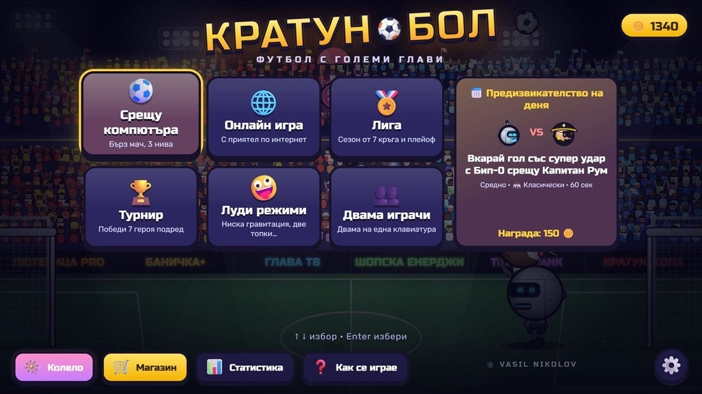
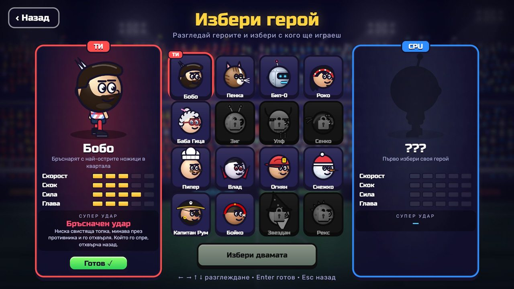
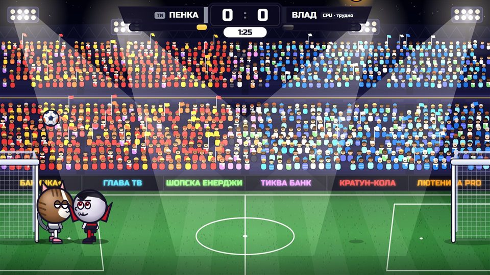
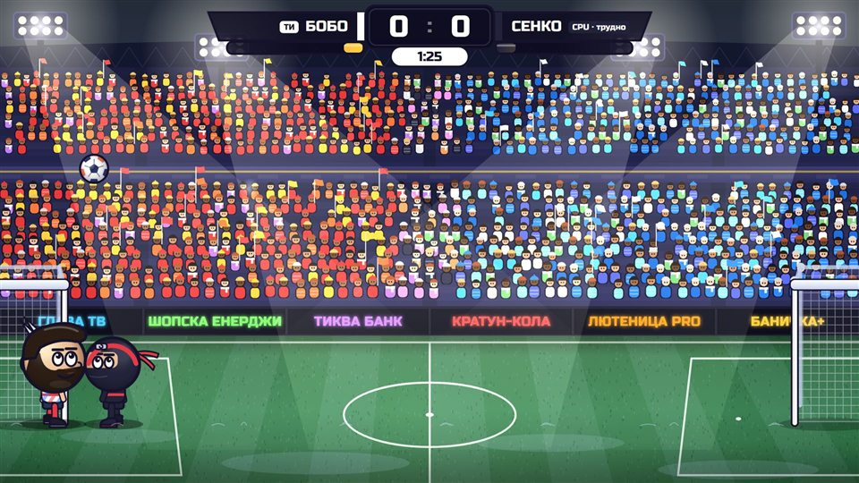
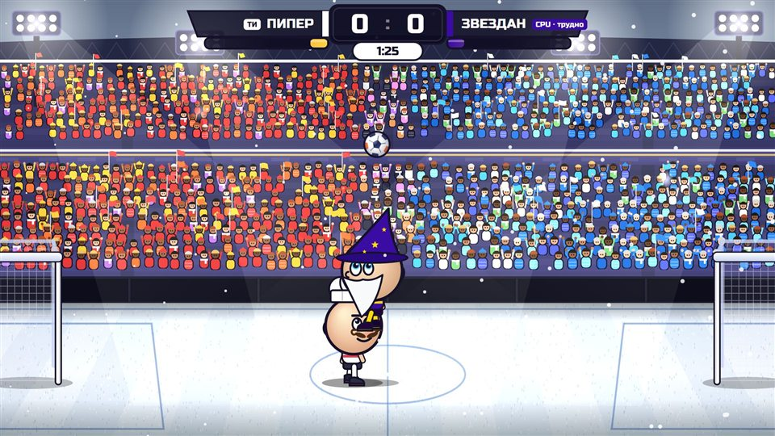
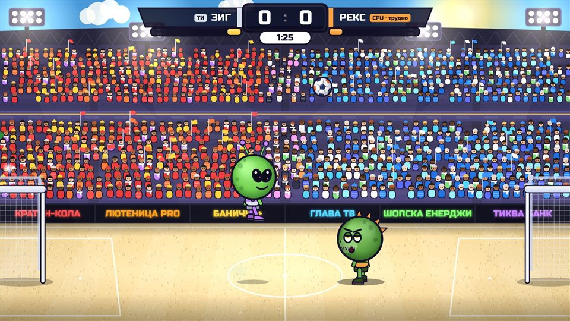
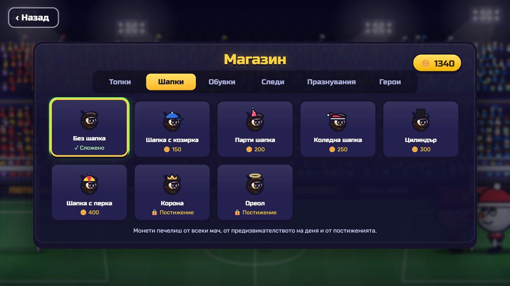
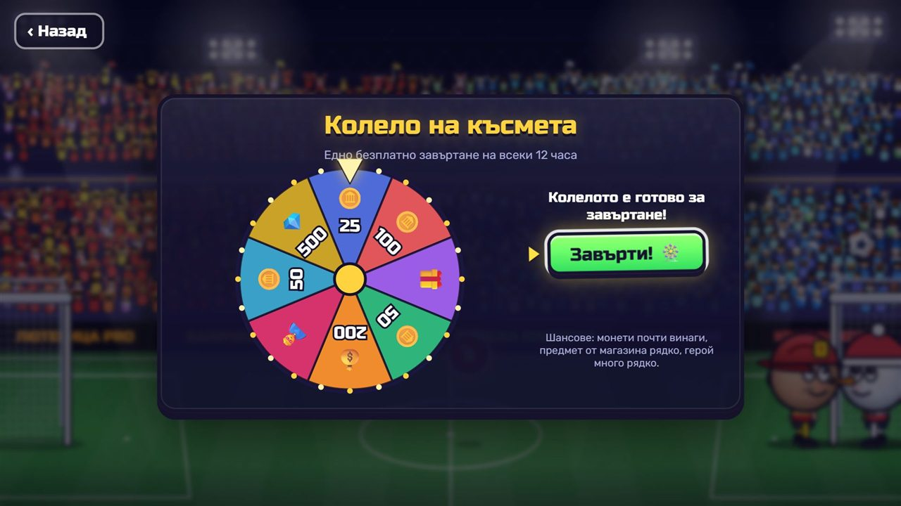

<div align="center">

# ⚽ Кратунбол

**Футбол с големи глави, 1 срещу 1**

16 герои с луди супер удари · 5 стадиона с различно време · лига, турнир и предизвикателство на деня · луди режими · магазин и колело на късмета · онлайн мачове с приятел

Играе се направо в браузъра, на компютър или на телефон. Без инсталация и без регистрация.

### [▶ ИГРАЙ СЕГА](https://vasilnikolov16.github.io/big-head-football/)

`vasilnikolov16.github.io/big-head-football`



</div>

---

## 📖 Съдържание

- [Как се играе](#-как-се-играе)
- [Управление](#️-управление)
- [На телефон](#-на-телефон)
- [Герои](#-герои)
- [Супер удар](#-супер-удар)
- [Бонуси](#-бонуси)
- [Режими](#-режими)
- [Стадиони](#️-стадиони)
- [Монети, магазин и колело](#-монети-магазин-и-колело)
- [Онлайн игра с приятел](#-онлайн-игра-с-приятел)
- [Настройки](#️-настройки)
- [Съвети](#-съвети)
- [English](#-english)

---

## 🎮 Как се играе

Вкарай повече голове от противника, преди да изтече времето. Ако е равно, следва **златен гол**: който вкара пръв, печели.


Топката е лека, като балон: подскача високо и отскача от главите, гредите и стената над вратите. Можеш да я удряш с глава, да я риташ във въздуха и да чакаш момента за супер удар. Ако двамата я ритнете едновременно, тя изскача нагоре и започва боричкане.

**Ритай и противника.** Ако той е точно пред теб, а топката не е при крака ти, ритникът го събаря за миг. После известно време не може да бъде ритнат пак, така че няма безкрайно ритане.

**Без губене на време на гредата.** Ако някой задържи топката отгоре на гредата, след около секунда тя отскача обратно в игра.

Играта започва с кратко шоу при зареждане: прожектори, логото с трясък и всички герои. Натисни където и да е и си в менюто.

## ⌨️ Управление

|                | Играч 1 (ляв) | Играч 2 (десен)       |
| -------------- | :-----------: | :-------------------: |
| Движение       | A / D         | ← / →                 |
| Скок           | W             | ↑                     |
| Ритник         | S             | ↓                     |
| Супер удар     | Left Shift    | Right Shift или Enter |
| **Даш**        | 2× A или 2× D | 2× ← или 2× →         |

- **Esc** или **P**: пауза.
- В менютата се движиш със стрелките, **Enter** избира, **Esc** връща назад.
- Всички клавиши се сменят от **Настройки → Контроли**.

## 📱 На телефон

Обърни телефона хоризонтално. Играта запълва целия екран.

| Къде | Бутони |
| ---- | ------ |
| Долу вляво | **◀ ▶**. Бързо двойно докосване е **даш**. |
| Долу вдясно | **Супер · Ритник · Скок**. Палецът може да се плъзга от бутон на бутон. |
| Горе вляво | **❚❚** пауза |

Размерът, прозрачността и мястото на всеки бутон се сменят от **Настройки → Бутони**. Там можеш просто да ги влачиш, където ти е удобно.

### 📲 Сложи я като приложение

Така играта има своя иконка, отваря се на цял екран без лентите на браузъра и работи и без интернет (освен онлайн играта).

- **iPhone / iPad:** отвори линка в **Safari** → **Сподели** (квадратчето със стрелка нагоре) → **Добави към началния екран**.
- **Android:** отвори линка в **Chrome** → менюто **⋮** → **Инсталирай приложението**.

Новите версии се зареждат сами, няма нищо за обновяване.

> 💬 **Искаш да играеш с приятел?** Просто му прати линка. След това е само Сподели → Добави към началния екран.

## 🦸 Герои



| Герой | Скорост | Скок | Сила | Глава | Супер удар | Ако го спреш… |
| ----- | :-----: | :--: | :--: | :---: | ---------- | ------------- |
| **Бобо**, бръснарят | 3 | 3 | 4 | 3 | **Бръсначен удар**: ниска свистяща топка | отхвърчаш назад |
| **Пенка**, котката | 4 | 5 | 2 | 3 | **Котешки скок**: задрямва във въздуха и се хвърля | издраскан и замаян |
| **Бип-0**, роботът | 2 | 2 | 5 | 4 | **Лазер**: права линия с огромна скорост | токов удар |
| **Роко**, рокерът | 4 | 3 | 3 | 3 | **Соло на китара**: звукова вълна | обърнато управление |
| **Баба Гица** | 2 | 2 | 3 | 5 | **Кълбо прежда**: самонасочва се | оплетен и бавен |
| **Пипер**, готвачът | 3 | 3 | 4 | 3 | **Горещ тиган**: палачинката се обръща и пада във вратата | опарен |
| **Влад**, вампирът | 4 | 4 | 3 | 2 | **Ято прилепи**: лети на зигзаг | губиш сила и енергия |
| **Огнян**, пожарникарят | 3 | 3 | 4 | 4 | **Воден маркуч**: ниска водна струя | отнася те |
| **Снежко**, снежният човек | 2 | 3 | 4 | 4 | **Лавина**: снежна топка, която расте | замръзваш |
| **Капитан Рум**, пиратът | 3 | 2 | 5 | 3 | **Гюле**: висока дъга и взрив | главата ти се смачква |
| **Бойко**, боксьорът | 4 | 3 | 4 | 2 | **Кроше**: излита и завива към вратата | нокдаун, объркани посоки |
| **Зиг**, извънземното 🔒 | 3 | 5 | 2 | 4 | **Телепорт**: появява се пред вратата | отвлечен нагоре |
| **Улф**, викингът 🔒 | 2 | 3 | 5 | 4 | **Гръм**: забива се като мълния | зашеметен |
| **Сенко**, нинджата 🔒 | 5 | 4 | 3 | 1 | **Сенки**: три топки, една истинска | забавен в облак дим |
| **Звездан**, магьосникът 🛒 | 3 | 4 | 3 | 4 | **Звездна магия**: скача през пространството | ставаш жаба и не скачаш |
| **Рекс**, динозавърът 🛒 | 3 | 2 | 5 | 4 | **Рев**: ударна вълна по земята | изхвърля те във въздуха |

🔒 Отключват се, като ги победиш в **Турнира** (те са последните противници). 🛒 Купуват се в **Магазина** (или се падат от колелото на късмета).

## ⚡ Супер удар


1. Лентата под името ти се пълни сама с времето и по-бързо, когато играеш с топката.
2. Когато е пълна, натисни **Супер**. Героят засиява и всеки чува неговия сигнал.
3. Следващото ти докосване на топката я хваща. Героят замръзва, топката се зарежда пред него и ударът изригва, със звук, който е само негов.

**Докато ударът се зарежда, противникът може да тича** (без даш), за да застане на пътя му. Около заредената топка има аура: не можеш да я задушиш, а трябва да прочетеш накъде ще полети.

Зареденият удар не изчезва след гол, но не може да се ползва, докато се празнува.

**Всеки супер удар може да бъде спрян**, но който го спре, си плаща: всеки герой има свой ефект (виж таблицата горе). Над главата на засегнатия се появява знак: 🐌 забавен, 🐸 не може да скача, 🔥 опарен, 💫 смачкана глава.

## 🎁 Бонуси

Падат с парашут и висят няколко секунди. Вземаш ги, като ги удариш с топката или ги докоснеш.

| Бонус | Какво прави |
| ----- | ----------- |
| 🔴 Голяма / малка топка | Топката расте или се смалява |
| 🟢 Висок скок | Скачаш по-високо |
| 🔥 Огнена топка | Ударите ти са по-силни, а горящата топка зашеметява противника |
| ❄️ Замразяване | Противникът замръзва в ледено блокче |
| 🎈 Голяма глава | Главата ти става огромна |
| 🥅 Малка врата | Твоята врата се смалява |
| 🔀 Обърнато управление | Ляво и дясно на противника се разменят |

Бонусите могат да се изключат от настройките.

## 🏆 Режими

| Режим | Какво е |
| ----- | ------- |
| ⚽ **Срещу компютъра** | Бърз мач. Четири нива: лесно, средно, трудно и 🧠 **експерт**. |
| 🌐 **Онлайн игра** | С приятел от друг компютър или телефон. |
| 🏅 **Лига** | 8 отбора, 7 кръга (3 точки за победа, 1 за равенство), таблица на живо, после полуфинали и финал. Шампионът взима купа, 500 🪙 и корона. Трудността се избира (и „Експерт“). |
| 🏆 **Турнир** | Победи 7 героя подред, от лесно към трудно. Последните противници са тайните герои: победиш ли ги, отключваш ги. Накрая те чака купа. Преди първия мач можеш да избереш **Експертен турнир**: по-силни противници (финалите са на „Експерт“) и двойна награда. |
| 📅 **Предизвикателство на деня** | Всеки ден нова задача, еднаква за всички (например „Вкарай гол със супер удар с Бип-0 срещу Капитан Рум“). Награда 150 🪙 веднъж на ден. |
| 🤪 **Луди режими** | **Ниска гравитация** (огромни скокове), **Двойна топка** (две топки едновременно), **Всеки удар е супер** (всеки ритник изстрелва супер удара). Срещу компютъра или срещу приятел. |
| 👥 **Двама играчи** | На една клавиатура. |

**🧠 Експерт:** компютърът реагира почти мигновено, избира кога да удари (ниско, с пълна сила или лоб), пази супер удара за момент, в който не можеш да се върнеш, и чете чуждите супер удари. В тестовете бие „Трудно“ в около 7 от 10 мача. Не мами със скорост или сила, просто играе по-умно.

**📊 Статистика и постижения:** мачове, голове, рекорди и 31 постижения. Всяко постижение носи 50 🪙, а някои отключват козметика, която не се продава.

## 🏟️ Стадиони

| | |
| :-: | :-: |
|  |  |
| 🌙 **Нощ:** тъмно небе и ярки прожектори | 🌧️ **Дъжд:** мокра трева, топката се плъзга, а героите се подхлъзват |
|  |  |
| ❄️ **Сняг:** по-тежка топка и по-бавни крака | 🏖️ **Плаж:** пясъкът поглъща отскока и спира топката |

Плюс 🏟️ **Класически** (вечерен мач, нормални условия) и 🎲 **Случаен**.

Стадионът се избира при игра срещу компютъра, в лудите режими и онлайн (там избира домакинът). Публиката живее: люлее се, прави мексиканска вълна, развява знамена и избухва с фотосветкавици след гол.

## 🛒 Монети, магазин и колело

Всеки мач носи монети: повече за победа, за по-трудно ниво, за всеки гол, за суха мрежа и за супер гол. Монети дават и турнирът, лигата, предизвикателството на деня, постиженията и колелото.



| Раздел | Какво има |
| ------ | --------- |
| ⚽ Топки | плажна, ретро, баскетболна, диня, златна, планета |
| 🎩 Шапки | с козирка, парти, коледна, цилиндър, с перка |
| 👟 Обувки | различни цветове |
| ✨ Следи | следа зад топката |
| 🎉 Празнувания | при гол: емоджи дъжд, мълнии, фойерверки |
| 🦸 Герои | Звездан и Рекс |

Преди всяка покупка играта пита „Сигурен ли си?“, така че нищо не се купува случайно.

**🏅 Само за постижения** (не се продават): корона, ореол, диско топка, ледени обувки, следа-дъга, звезден дъжд и празнуването „Пари!“.

### 🎡 Колело на късмета



Едно безплатно завъртане на **всеки 12 часа**.

| Награда | Шанс |
| ------- | :--: |
| 🪙 Монети (от 25 до 500) | 89% |
| 🎁 Предмет от магазина | 9% |
| 🦸 Герой | 2% |

Ако вече имаш всичко, вместо предмета или героя получаваш монети.

## 🌐 Онлайн игра с приятел

1. Двамата избирате **Онлайн игра** и всеки си пише име.
2. Единият натиска **Създай стая** и праща кода от 4 знака (например `K7QX`) на приятеля си. Може и с **Копирай линк**: който отвори линка, влиза направо.
3. Другият пише кода и натиска **Влез в стая**.
4. Домакинът избира продължителност, бонуси, стадион и дали мачът да е в някой от лудите режими → **Към героите**. Всеки избира герой и натиска **Готов**, а домакинът натиска **СТАРТ**.
5. След мача: **Реванш**, **Смени герой** или **Напусни стаята**.

По време на мача **1 2 3 4** (или 😀 на телефона) пращат емотикони. Горе вдясно се вижда пингът. Всеки вижда шапката, обувките и празнуванията на другия.

При слаб интернет в **Настройки → Онлайн** избери **Гладко**. Ако искаш най-малко забавяне, избери **Бързо**.

## ⚙️ Настройки

Отварят се от зъбното колело ⚙️ на главния екран.

| Раздел | Какво има |
| ------ | --------- |
| 🔊 Звук | звуци, музика, публика |
| 🎮 Игра | продължителност, трудност, бонуси, повторение на гола, кино момент при супер |
| 🖥️ Екран | тресене на екрана, качество (и пестене на батерия), брояч на кадри |
| 📱 Бутони | показване, размер, прозрачност и подреждане на бутоните на телефона |
| ⌨️ Контроли | смяна на клавишите |
| 🌐 Онлайн | име, плавност, пинг |
| 🌍 Език | български / English |

Прогресът (монети, герои, постижения, покупки) и настройките се пазят в браузъра на устройството.

## 💡 Съвети

- **Задръж скока** за по-висок скок.
- **Ритникът е най-силен,** ако натиснеш малко преди топката да стигне крака. Късният ритник я праща високо.
- **Дашът** те спасява, когато топката ти избяга. Ако се засилиш в противника, го събаряш за миг.
- **Удар с глава в скок** е много по-силен от удар с глава от място.
- **Пази супер удара** за момент, в който противникът е далеч от вратата си: докато ударът се зарежда, той ще тича да се върне.
- **Когато противникът зарежда супер,** тичай към вратата си и застани на пътя на удара. Спреш ли го, ще понесеш ефекта, но без гол.
- **Не спирай всеки супер.** Понякога е по-добре да се махнеш, отколкото да станеш жаба. 🐸
- **Върти колелото** всеки път, когато е готово: два пъти на ден е безплатно.

---

## 🇬🇧 English

**Kratunball** is a 1v1 big-head football game that runs in the browser on desktop and phone. Switch the language in **Settings → Language**.

**[▶ Play now](https://vasilnikolov16.github.io/big-head-football/)**

- **16 heroes**, each with their own super shot. Every super can be blocked, but the blocker gets a hero-specific effect: frozen, turned into a frog, knocked out and more. While a super charges, the defender can still run to get in its way.
- **Modes:** vs CPU (4 levels, up to Expert), online with a friend (room codes), league (8 teams + playoffs), tournament (beat 7 in a row; the last ones are secret heroes you unlock by beating them; an Expert ladder for double the prize), daily challenge, crazy modes (low gravity, double ball, every kick is a super) and 2 players on one keyboard.
- **5 stadiums** with weather that changes the physics: classic, night, rain, snow and beach.
- **Coins, shop and cosmetics:** balls, hats, boots, trails and goal celebrations, plus a **wheel of fortune** every 12 hours and 31 achievements.
- **Controls:** P1 `A D` move, `W` jump, `S` kick, `Left Shift` super. P2 uses the arrows, `↓` kick and `Right Shift` super. Double-tap a direction to dash.
- **On a phone:** play in landscape with on-screen buttons. Add it to the home screen (Safari → Share → Add to Home Screen, or Chrome → ⋮ → Install app) for a full-screen app that also works offline.

---

<details>
<summary><b>🛠️ За разработчици</b></summary>

<br>

Направена с **TypeScript**, **Vite** и **Canvas 2D**. Онлайн играта е директна връзка между двамата играчи (WebRTC чрез PeerJS). Няма сървър за играта.

```bash
npm install
```

```bash
npm run dev
```

```bash
npm run build
```

- `src/game`: мачът, героите, супер ударите, кариерата, магазинът, лигата, колелото
- `src/physics`: топката, арената, сблъсъците
- `src/render`: стадионът, героите, ефектите, публиката
- `src/audio`: звуците и музиката, синтезирани в реално време
- `src/net`: онлайн играта
- `src/ui`: менютата, магазинът, настройките, loading екранът

Всеки push към `main` се публикува автоматично в GitHub Pages.

</details>

<div align="center">

Цялата графика, музиката и звуците в играта са нарисувани и синтезирани с код, без нито една картинка или аудио файл.

**Игра от Vasil Nikolov** ⚽

</div>
